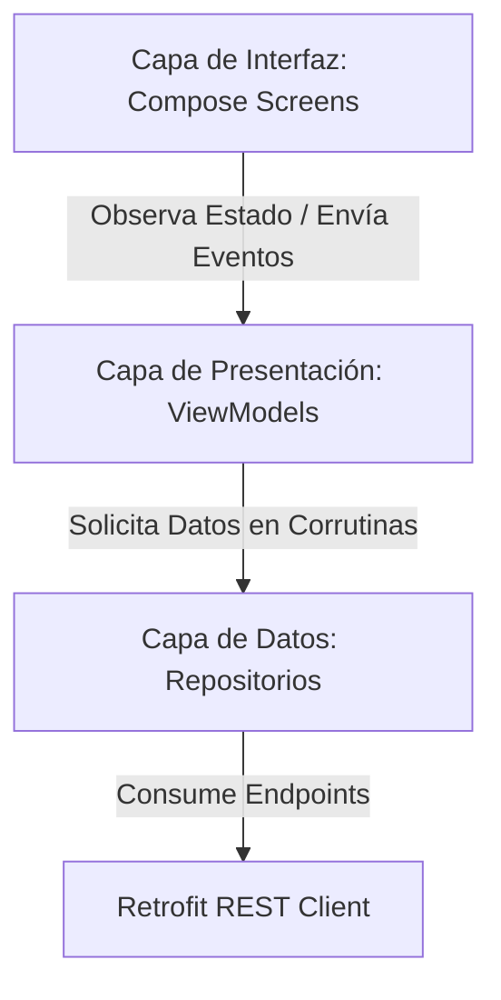

# Reporte de Diagnóstico y Plan de Arquitectura Móvil: DomuxApp

Este documento contiene el análisis técnico de la aplicación móvil **DomuxApp** (Kotlin + Jetpack Compose) basado en los lineamientos exigidos por las guías de formación SENA (GA1 a GA4) y las recomendaciones de modernización de arquitectura.

---

## 1. Estado Actual del Proyecto (¿Qué está listo?)

La aplicación móvil actualmente cumple con el **100% de la funcionalidad básica e intermedia** descrita en las guías GA1, GA2 y GA3:

*   **Capa de Red (`data/`):**
    *   `ApiService.kt` tiene todas las rutas mapeadas correctamente (`@GET`, `@POST`, `@PUT`).
    *   `RetrofitClient.kt` cuenta con soporte para URLs dinámicas por entorno (`dev` para local y `prod` para el backend en la nube en **Render**) y posee un tiempo de espera robusto (**60 segundos de Timeout**) para mitigar el arranque lento (*Cold Start*) del servidor gratuito.
*   **Gestión de Datos y Modelos:**
    *   `Models.kt` se encuentra sincronizado con los diccionarios de Python (`to_dict()`) del backend.
    *   `Session.kt` maneja de forma centralizada el estado global de la sesión (Token Bearer y Roles `ADMIN`, `RESIDENT`, `GUARD`) en la memoria de la aplicación.
*   **Flujo de Pantallas y Navegación:**
    *   `MainActivity.kt` implementa el `NavHost` con las 7 rutas del sistema.
    *   Las pantallas manejan correctamente el control de acceso visual (`if (Session.isAdmin)`, etc.) y consumen la API de forma directa.

---

## 2. Diagnóstico de Brechas (¿Qué falta según la GA4?)

Aunque el código actual es funcional y sigue los ejemplos guiados iniciales, el módulo de **Transferencia de Conocimiento de la Guía GA4 (Sección 3.4)** y los estándares de desarrollo profesional exigen dar el salto hacia una **Arquitectura en Capas Limpia (MVVM - Model-View-ViewModel)**.

### Brechas identificadas:
1.  **Lógica acoplada a la interfaz (Inline):** Las llamadas a la red (`RetrofitClient.api.login`, etc.) y el control de hilos (`scope.launch`) ocurren directamente dentro de los componentes visuales de Compose. Si el usuario rota la pantalla o minimiza la app, las llamadas en curso pueden romperse y el estado (`loading`, `result`) se destruye.
2.  **Falta de Repositorios:** No existe una capa que aísle las fuentes de datos (red) de la lógica de negocio.
3.  **Falta de ViewModels:** No se están utilizando componentes que retengan y sobrevivan a los cambios de configuración del ciclo de vida de Android.

---

## 3. Plan de Acción Técnico (Estructura Propuesta)

Para llevar el proyecto al **100% de nivel profesional para el Proyecto Integrador (GA4)**, se propone refactorizar el flujo modularizando el código en las siguientes tres capas:

### Plan de Archivos a Implementar por el Equipo:

### A. Capa de Datos (Data Layer)
*   **[NEW] `AuthRepository.kt`:** Aislará las llamadas de autenticación.
*   **[NEW] `CommunityRepository.kt`:** Gestionará los anuncios, las reservas de zonas comunes y las PQRS.
*   **[NEW] `SecurityRepository.kt`:** Controlará el registro de paquetes y el ingreso de visitantes (Portería).

### B. Capa de Presentación (Presentation Layer)
*   **[NEW] `LoginViewModel.kt`, `PqrsViewModel.kt`, `RegistryViewModel.kt`:**
    *   Heredarán de `ViewModel()`.
    *   Utilizarán `MutableStateFlow` y clases selladas (`Sealed Classes`) para representar los 4 estados requeridos por la GA4: `Idle` (Inactivo), `Loading` (Cargando), `Success` (Éxito) y `Error`.

### C. Capa de UI (Modificación)
*   **[MODIFY] Screens (`LoginScreen.kt`, etc.):** Se removerán los `remember { mutableStateOf }` locales de datos y los `rememberCoroutineScope`. Ahora recibirán el `ViewModel` correspondiente, observarán su estado y pintarán los componentes de manera puramente declarativa.

---

> [!IMPORTANT]
> **Nota de Tranquilidad para el Equipo:** El comportamiento de las pantallas, el diseño visual de Material 3 y la lógica de endpoints hacia **Render** ya están perfectos. Esta refactorización no alterará lo que la app *hace*, sino *cómo organiza el código* internamente para cumplir con la máxima calificación de la rúbrica técnica de la GA4.
