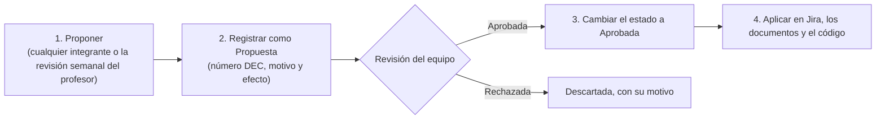

# DOMUX · Registro de decisiones

3 de noviembre de 2026 · Maicol Esneider Posada Callejas

Este documento reúne todas las decisiones del proyecto DOMUX con su motivo, su fecha y su efecto, para que Jira, GitHub y la documentación digan lo mismo.

## Datos del documento

| Campo | Valor |
| --- | --- |
| Proyecto | DOMUX: sistema para la gestión de unidades residenciales en Colombia (app Android, página web de administración y servidor) |
| Institución | Servicio Nacional de Aprendizaje (SENA), Regional Antioquia |
| Centro de formación | Centro de Tecnología de la Manufactura Avanzada (CTMA), Medellín |
| Programa | Tecnología en Análisis y Desarrollo de Software (ADSO), ficha 3223873 |
| Instructor | Richard Alexander Betancur Sierra (DEC-095) |
| Equipo | Maicol Esneider Posada Callejas · Sebastián Lein Castro Grajales · Nicolás Muñoz Hernández |
| Elaboró | Maicol Esneider Posada Callejas |
| Revisó y aprobó | Sebastián Lein Castro Grajales y Nicolás Muñoz Hernández: aprobación de DEC-001 a DEC-070, informada el 3 de noviembre de 2026. Maicol Esneider Posada Callejas: DEC-071 a DEC-096. |
| Versión | 1.8 · DEC-001 a DEC-070 aprobadas por el equipo; DEC-071 a DEC-096, por Maicol (DEC-091 es una propuesta) |
| Fecha | 4 de noviembre de 2026 |
| Código y tarea en Jira | ART-03 · [SCRUM-140](https://sebastiancastro4848.atlassian.net/browse/SCRUM-140) |
| Archivo en el repositorio | `docs/adr/registro-decisiones.md`, con un archivo por cada ADR en `docs/adr/`, en [MAICOL-ESNEIDER/domux-ga4](https://github.com/MAICOL-ESNEIDER/domux-ga4) |
| Versión del producto | Reducida 1.0 (entrega del 1 de diciembre de 2026); se anotan también las decisiones que afectan a la Completa 2.0 y a la Futura |

## Control de versiones

| Versión | Fecha | Autor | Cambios |
| --- | --- | --- | --- |
| 0.1 | 3 nov 2026 | Maicol Esneider Posada Callejas | Primera versión: 70 decisiones (DEC-001 a DEC-070), historial de decisiones reemplazadas, pendientes, procedimiento, glosario y referencias. |
| 1.0 | 3 nov 2026 | Sebastián Lein Castro Grajales y Nicolás Muñoz Hernández (revisión) | Aprobación del equipo de DEC-001 a DEC-070. DEC-070 pasa de Propuesta a Aprobada. |
| 1.1 | 3 nov 2026 | Maicol Esneider Posada Callejas | Agrega DEC-071 a DEC-074 y R-12, el centro de formación y la investigación sobre datos de visitantes. Cierra P-01, P-02, P-03, P-08 y P-09; actualiza P-04 y P-07. |
| 1.2 | 3 nov 2026 | Maicol Esneider Posada Callejas | Agrega DEC-075 (el proyecto se identifica solo como DOMUX) y R-13. |
| 1.3 | 3 nov 2026 | Maicol Esneider Posada Callejas | Agrega DEC-076 a DEC-085 por los formatos oficiales del profesor y R-14. DEC-064 pasa a Reemplazada; DEC-078 y DEC-085 quedan como propuestas. Las tareas de documentación cambian de código (DEC-082). Cierra P-07 y abre P-11. |
| 1.4 | 3 nov 2026 | Maicol Esneider Posada Callejas | Agrega DEC-086 (más tareas para Nicolás) y DEC-087 (los documentos del profesor no se copian). DEC-078 y DEC-085 pasan a Aprobada. Cierra P-11. |
| 1.5 | 3 nov 2026 | Maicol Esneider Posada Callejas | Agrega DEC-088 (tareas para Sebastián). Corrige el código del Índice Maestro en DEC-065, DEC-082, DEC-083 y DEC-087: no tiene código propio, porque en el Índice Maestro oficial GOB-01 es la Arquitectura Documental del profesor. |
| 1.6 | 4 nov 2026 | Maicol Esneider Posada Callejas | Agrega DEC-089: los documentos se hacen sobre las plantillas Word del profesor, que llegaron completas el 4 de noviembre. DEC-066 pasa a Reemplazada (R-15). |
| 1.7 | 4 nov 2026 | Maicol Esneider Posada Callejas | Agrega DEC-090 a DEC-094: nada se borra y los datos viejos pasan a un archivo JSON comprimido (DEC-090), anonimización a los 10 años (DEC-091, propuesta), bloqueo de 15 minutos (DEC-092), semáforo de PQRS de 15 días hábiles (DEC-093) y Jira al final (DEC-094). DEC-074 pasa a Reemplazada (R-16). Agrega la investigación del 4 de noviembre. |
| 1.8 | 4 nov 2026 | Maicol Esneider Posada Callejas | Agrega DEC-095 (los documentos llevan el nombre del instructor actual) y DEC-096 (toda la documentación queda a nombre de Maicol). DEC-067 y DEC-077 pasan a Reemplazada (R-17 y R-18). DEC-056, DEC-086 y DEC-088 quedan ajustadas por DEC-096. |

Cada cambio posterior suma una fila (1.9, 1.10…).

## 1. Introducción y propósito

Este registro es la fuente única de las decisiones de DOMUX: qué se decidió, por qué, cuándo y qué cambia en el proyecto. Reúne 96 decisiones tomadas entre el 21 de octubre y el 4 de noviembre de 2026, más el historial de lo que se reemplazó.

Sirve para cuatro cosas:

- **Evitar repetir debates.** Si algo ya se decidió, se consulta aquí antes de volver a discutirlo.
- **Mantener todo sincronizado.** Cada decisión dice qué historias o tareas de Jira la llevan a cabo; los commits citan esas claves y los demás documentos citan el código DEC. Así Jira, GitHub y la documentación dicen lo mismo, como pide el profesor.
- **Explicar los cambios.** El proyecto pasó de una plataforma web para muchos conjuntos a una app Android con web de administración. El historial (sección 14) muestra esa evolución y su motivo.
- **Dejar claro quién decide y qué falta.** Las decisiones sin confirmar quedan en la sección 15 hasta que el equipo las apruebe.

Los demás documentos parten de este: el alcance, los requisitos, el backlog, la arquitectura y los manuales deben coincidir con lo que dice aquí. Si una decisión cambia, primero se actualiza este registro y después Jira y los documentos afectados.

## 2. Alcance del registro

El registro cubre las decisiones del proyecto actual (repositorio domux-ga4, iniciado el 11 de septiembre de 2026) que afectan el producto, la técnica, la gestión o la documentación. Lo anterior (la plataforma web para muchos conjuntos, de mayo a septiembre) y las ideas que se cambiaron después quedan en el historial de la sección 14.

**Fuentes de las decisiones**

| Fuente | Fecha | Qué aporta |
| --- | --- | --- |
| Encuesta de decisiones del Informe de la Etapa 1 | 21 a 27 de octubre de 2026 | Alcance, exclusiones, fecha de entrega, piloto y prioridades |
| Documento maestro de decisiones y funcionalidades | Recibido el 27 de octubre de 2026 | Las 12 funcionalidades de la versión completa, roles y reglas generales |
| Sesiones de trabajo sobre el alcance, la tecnología y las reglas | 27 a 30 de octubre de 2026 | Versiones, tecnología, roles financieros, reglas de negocio y reparto del trabajo |
| Revisión del backlog y reorganización de Jira | 30 de octubre a 2 de noviembre de 2026 | Numeración, responsables, Sprint VR-1 y código limpio |
| Revisión del repositorio | 2 de noviembre de 2026 | Ramas, commits y estructura de la documentación |
| Respuestas del equipo e investigación de políticas de datos de conjuntos | 3 de noviembre de 2026 | Aprobación, centro de formación, unidad de prueba, parqueo de visitantes y conservación de sus datos |
| Indicaciones de Maicol e investigación de otros conjuntos | 4 de noviembre de 2026 | Plantillas Word, conservación y archivo de los datos, bloqueo, semáforo de PQRS, orden con Jira, instructor y responsable de la documentación |

**Quién decide.** Maicol Esneider Posada Callejas, como responsable del desarrollo y de la documentación en esta etapa, toma las decisiones de este registro. Sebastián Lein Castro Grajales y Nicolás Muñoz Hernández aprobaron DEC-001 a DEC-070 (versión 1.0). El instructor que revisa el proyecto, Richard Alexander Betancur Sierra, da recomendaciones cada semana, y las que cambien algo entran aquí como decisiones nuevas.

**Cómo se trabajó.** El análisis de documentos, código y Jira se hizo con apoyo de una herramienta de inteligencia artificial, para agilizar el trabajo; las decisiones son del equipo.

**Qué no está aquí.** El detalle de cada requisito (va en Alcance y requisitos, DOC-10), de cada historia (va en el backlog, DOC-11) y los cambios menores de código (van en los commits).

## 3. Cómo leer el registro

Cada decisión es una fila con siete campos. Los campos combinan lo que pide un registro de decisiones de proyecto ([The Digital Project Manager](https://thedigitalprojectmanager.com/es/gestion-de-proyectos/registro-de-decisiones/)) con el contexto, la decisión y las consecuencias de los registros de decisiones de arquitectura ([ADR](https://adr.github.io/adr-templates) y [MADR](https://ozimmer.ch/practices/2022/11/22/MADRTemplatePrimer.html)).

| Campo | Qué contiene |
| --- | --- |
| ID | Código único DEC-001, DEC-002… Nunca se reutiliza, aunque la decisión se reemplace. |
| Decisión | Qué se decidió, en una o dos frases. |
| Por qué | El motivo y, cuando las hubo, las opciones que se descartaron. |
| Efecto | Qué cambia en el producto, en Jira, en el código o en la documentación. |
| Fecha | Cuándo se tomó o se registró. Las anteriores al 3 de noviembre se reconstruyeron de las sesiones de trabajo y los documentos; por eso algunas son un rango de días. |
| Estado | Propuesta, Aprobada, Reemplazada o Descartada (tabla siguiente). |
| En Jira o fuente | La historia, tarea o épica de Jira que la lleva a cabo, o el documento de donde sale. |

**Estados**

| Estado | Significa |
| --- | --- |
| Propuesta | Está escrita pero falta que el equipo la confirme. |
| Aprobada | Está vigente y se debe cumplir. |
| Reemplazada | Una decisión más nueva la cambió; se anota cuál. |
| Descartada | Se estudió y no se adoptó; se deja con su motivo. |

**Categorías.** Las decisiones se agrupan en nueve categorías, de la sección 5 a la 13: alcance y versiones, funciones de la reducida, roles, reglas de negocio, tecnología, seguridad, interfaz, gestión y documentación.

**Siglas.** HU es historia de usuario, TT tarea técnica, DOC tarea de documentación y EP épica. Las demás siglas están en el glosario (sección 17).

## 4. Resumen

Hay 96 decisiones: 90 aprobadas, 1 propuesta (DEC-091) y 5 reemplazadas (DEC-064, DEC-066, DEC-067, DEC-074 y DEC-077).

| Categoría | Decisiones | Cuántas | Lo más importante |
| --- | --- | --- | --- |
| Alcance y versiones | DEC-001 a DEC-010 y DEC-072 | 11 | Versión reducida el 1 de diciembre en local, una sola unidad, exclusiones y pruebas con una unidad inventada |
| Funciones de la reducida | DEC-011 a DEC-017 | 7 | Portería vehicular, estructura de la unidad, finanzas a la completa |
| Roles y permisos | DEC-018 a DEC-024 | 7 | 3 roles en la reducida y 11 en la completa; web solo para administración |
| Reglas de negocio | DEC-025 a DEC-035, DEC-073, DEC-092 y DEC-093 | 14 | Contraseñas, bloqueo de 15 minutos tras 5 intentos, residentes que se van, reglas configurables, 3 días de parqueo para visitantes y semáforo de PQRS de 15 días hábiles |
| Tecnología y arquitectura | DEC-036 a DEC-045 | 10 | Flask, Kotlin y PostgreSQL con Flask-Migrate; pocas tecnologías; código limpio |
| Seguridad y datos personales | DEC-046 a DEC-049, DEC-074, DEC-090 y DEC-091 | 7 | Leyes 1581 y 675, autorización de datos, seguridad básica, nada se borra y archivo JSON comprimido de los datos viejos |
| Diseño de la interfaz | DEC-050 a DEC-053 | 4 | Se mantiene la paleta; pantallas claras y accesibles |
| Gestión, Jira y GitHub | DEC-054 a DEC-064, DEC-078, DEC-082, DEC-084, DEC-086, DEC-088, DEC-094 y DEC-096 | 18 | Sprint VR-1, reparto del trabajo, commits en español con la clave de Jira, roles del equipo, códigos oficiales en Jira, Jira al final y toda la documentación a nombre de Maicol |
| Documentación | DEC-065 a DEC-071, DEC-075 a DEC-077, DEC-079 a DEC-081, DEC-083, DEC-085, DEC-087, DEC-089 y DEC-095 | 18 | Formatos y plantillas Word del profesor como guía oficial, registro en docs/adr, declaración formal de IA, y portadas con DOMUX y el nombre del instructor actual |

## 5. Decisiones de alcance y versiones

Estas 11 decisiones (DEC-001 a DEC-010 y DEC-072) fijan qué se entrega el 1 de diciembre de 2026 y qué queda para después.

| ID | Decisión | Por qué | Efecto | Fecha (2026) | Estado | En Jira o fuente |
| --- | --- | --- | --- | --- | --- | --- |
| DEC-001 | Hacer dos versiones del producto y una lista futura: **Reducida 1.0** para la entrega al SENA, **Completa 2.0** para 2027 y **Futura** para ideas posteriores. | No alcanza el tiempo para las 12 funciones antes del 1 de diciembre. La reducida es la misma idea con menos funciones. | Cada historia de Jira tiene su versión. La documentación describe la reducida y anota lo que es de la completa. | 27–29 oct | Aprobada | Versiones de Jira: Reducida 1.0, Completa 2.0 y Futura |
| DEC-002 | Entregar la versión reducida el **1 de diciembre de 2026**, funcionando en local: APK, página web de administración y servidor. | Es la fecha de entrega del SENA. Reemplaza el cierre del 23 de diciembre que tenía el acta de constitución. | La versión Reducida 1.0 vence el 1 de diciembre; los sprints se planean hasta esa fecha. | 21–27 oct | Aprobada | Versión Reducida 1.0 |
| DEC-003 | La versión reducida incluye: en la app, inicio de sesión, menú, comunicados, PQRS, reservas básicas, paquetería y visitas con QR; además, portería vehicular básica y una página web solo de administración. | Aprovecha lo que ya existe en el código y cubre los problemas más urgentes de la unidad (portería, comunicados, PQRS). | El backlog quedó en 13 épicas (EP-01 a EP-13) con 126 elementos. | 27–30 oct | Aprobada | EP-01 a EP-13 |
| DEC-004 | Las funciones que entran en la reducida se hacen completas, no a medias, según la tabla por módulo (MUST, SHOULD o versión completa). | Una función a medias no sirve para la demostración ni para un piloto real. | Cada módulo tiene sus historias MUST en la reducida y deja lo avanzado para la completa. | 30 oct | Aprobada | Backlog aprobado |
| DEC-005 | No se incluye en ninguna versión: app para iOS; cámaras, biometría, RFID o torniquetes; chat o videollamadas; inteligencia artificial dentro del producto; facturación electrónica o integración contable; varios idiomas; uso 100 % sin conexión. | Exigen hardware, cuestan dinero cada mes o necesitan más tiempo y personas de las que hay. | La pasarela de pagos queda para la completa y la venta a varios conjuntos para la futura (ver DEC-006 y DEC-013). | 21–27 oct | Aprobada | Encuesta, pregunta A2 |
| DEC-006 | Trabajar primero con **una sola unidad residencial**. Vender DOMUX a varios conjuntos a la vez (multi-tenant) queda para el futuro. | Primero debe funcionar bien en una unidad. Separar los datos de muchos conjuntos complica todo desde el inicio. | La épica de varios conjuntos y sus historias quedaron en la versión Futura. | 21–27 oct | Aprobada | SCRUM-12 \[Futura\] |
| DEC-007 | Probar con un conjunto real: Maicol buscará uno. El modelo de negocio es una prueba gratis de 15 días a 1 mes y luego una suscripción. | Validar con usuarios reales y que el proyecto pueda generar ingresos. | Antes del piloto deben estar la autorización de datos personales y la seguridad básica (DEC-047 y DEC-048). | 21–27 oct | Aprobada | Encuesta, preguntas A4 y A8 |
| DEC-008 | Orden de desarrollo: primero la app (usuarios, inicio de sesión y menús; luego comunicados, PQRS, reservas, paquetería y QR) y después la web. La importación de datos desde Excel queda de último. | Lo que más se usa a diario es la app. La importación solo hace falta al cargar un conjunto real. | En la reducida, la web de administración se hace en el Sprint VR-1 junto con lo que falta de la app. La importación quedó en la versión Completa. | 27–29 oct | Aprobada | SCRUM-67 \[Completa\] |
| DEC-009 | Los repositorios anteriores (SebasLein/DOMUX y SebasLein/Final\_Project\_v4) se mencionan como iteraciones descartadas por complejidad, con fines académicos. | Muestran cómo evolucionó el proyecto sin confundir el alcance actual. | El trabajo vigente está en MAICOL-ESNEIDER/domux-ga4. Las tareas viejas de Jira tienen comentarios que lo explican. | 30 oct | Aprobada | SCRUM-125, 126, 127 y 131 |
| DEC-010 | La versión completa tendrá las 12 funcionalidades del Documento maestro, incluidos los clasificados (F11) y el tablero de gestión (F12). | Es el producto que se quiere vender a los conjuntos. | Las épicas de la completa quedaron en Jira con el prefijo \[Completa\]. | 27–29 oct | Aprobada | Épicas \[Completa\] en Jira |
| DEC-072 | Mientras no haya un conjunto real, las pruebas de la versión reducida se hacen con una unidad inventada: el **Conjunto Residencial Mirador del Norte P.H.**, con datos de prueba. Las pruebas en un conjunto real quedan para después de la entrega. | Todavía no hay un conjunto real dispuesto a probar DOMUX. | Las pruebas internas y la demostración usan los datos de la unidad de demostración. DEC-007 sigue vigente, pero su piloto real será después del 1 de diciembre. | 3 nov | Aprobada | Documento "Unidad de demostración" |

## 6. Decisiones sobre las funciones de la versión reducida

Estas 7 decisiones (DEC-011 a DEC-017) definen qué hace la versión reducida en cada módulo.

| ID | Decisión | Por qué | Efecto | Fecha (2026) | Estado | En Jira o fuente |
| --- | --- | --- | --- | --- | --- | --- |
| DEC-011 | La **portería vehicular básica** entra en la reducida: entrada y salida por placa, parqueaderos de visitantes y su ocupación en tiempo real. | Es parte del control de acceso diario y ya había historias para eso en Jira. | Épica EP-04 con 8 elementos. | 27–29 oct | Aprobada | EP-04 (SCRUM-17), HU-035 a HU-040 |
| DEC-012 | Las funciones del administrador están en la app y también en la página web. | El administrador trabaja desde el computador, pero también necesita resolver cosas desde el celular. | La web repite las funciones de administración de la app. | 30 oct | Aprobada | EP-10 (SCRUM-142) |
| DEC-013 | El estado de pago y toda la parte financiera pasan a la versión completa. | Necesitan reglas legales y contables que no alcanzan para el 1 de diciembre. | Reemplaza el estado de pago informativo del documento de octubre. | 30 oct | Aprobada | SCRUM-37 \[Completa\] Pagos |
| DEC-014 | Se mantiene la conversación dentro de cada PQRS y de cada reserva. No habrá chat general entre vecinos: en la completa solo un botón de WhatsApp en los clasificados. | Las conversaciones dentro del trámite ya funcionan y dejan evidencia. Un chat general cuesta almacenamiento y moderación. | La conversación de PQRS y reservas está hecha. El botón de WhatsApp quedó en la completa. | 30 oct | Aprobada | HU-054, HU-068, SCRUM-144 |
| DEC-015 | En la ficha del hogar se conservan integrantes, mascotas, vehículos, parqueadero y cuarto útil. Se quita el plan funerario. En mascotas se registra si tienen la vacunación y la desparasitación al día, con la fecha de la última. | El plan funerario no aporta a la operación del conjunto; la vacunación sí la exigen las normas de convivencia. | Ajuste al modelo de datos de mascotas en el Sprint VR-1. | 30 oct | Aprobada | HU-020, HU-021 |
| DEC-016 | La reducida incluye la estructura básica de la unidad: torres, apartamentos, parqueaderos de residentes y visitantes, cuartos útiles con código y la vinculación de cada residente con su apartamento y tipo de ocupación. | Sin esta estructura no se pueden asignar parqueaderos, paquetes ni visitas a un apartamento real. | Se reemplaza el campo de texto "apartamento" por registros de verdad. | 27–30 oct | Aprobada | HU-013 a HU-018, HU-076 |
| DEC-017 | Los comunicados tienen categoría (mantenimiento, urgente, asamblea, seguridad o zonas comunes) y el residente ve cuáles no ha leído. | Permite encontrar y priorizar los comunicados. | Dos historias en el Sprint VR-1: HU-058 es nueva y HU-059 reutiliza una historia vieja de Jira. | 2 nov | Aprobada | HU-058, HU-059 |

## 7. Decisiones de roles y permisos

Estas 7 decisiones (DEC-018 a DEC-024) definen quién usa DOMUX y desde dónde.

| ID | Decisión | Por qué | Efecto | Fecha (2026) | Estado | En Jira o fuente |
| --- | --- | --- | --- | --- | --- | --- |
| DEC-018 | La versión reducida tiene 3 roles: administrador, residente y guardia. | Son los que ya existen en el código y alcanzan para las funciones de la reducida. | Los demás roles quedan para la completa. | 27–30 oct | Aprobada | HU-002, HU-011 |
| DEC-019 | La versión completa tendrá 11 roles: propietario, arrendatario, familiar, guardia, operador de zonas húmedas, instructor temporal, administrador, contador, consejo, comité de convivencia y revisor fiscal. | Son los que necesita una unidad grande, según el Documento maestro, más el revisor fiscal. | Épica de roles y permisos avanzados en la completa. | 27–29 oct | Aprobada | SCRUM-14 \[Completa\] |
| DEC-020 | La página web es solo para roles administrativos: administración, contador, revisor fiscal, consejo y comité. Propietarios, residentes y arrendatarios usan la app. | Evita construir cada pantalla dos veces y concentra la web en quien trabaja desde un computador. | Reemplaza la idea de una web reducida para residentes (ver sección 14). | 27–29 oct | Aprobada | EP-10 |
| DEC-021 | El contador tiene una cuenta web de solo lectura, limitada a pagos, con exportación de recaudos a Excel (versión completa). | Le quita una tarea al administrador y reduce el riesgo de modificaciones o fraude. | El contador no valida pagos: lo hace el administrador. | 27–29 oct | Aprobada | SCRUM-14 \[Completa\] |
| DEC-022 | El revisor fiscal tiene una cuenta web de solo lectura de todo lo financiero: pagos, cartera, multas, gastos, actas e historial de ajustes, con exportación de recaudos (versión completa). | Su trabajo es revisar, no modificar. | Rol nuevo en la completa. | 27–29 oct | Aprobada | SCRUM-14 \[Completa\] |
| DEC-023 | El supervisor de vigilancia no tiene cuenta: solo se guarda como contacto para llamar. | No necesita registrar nada en el sistema. | Un rol menos que mantener. | 27–29 oct | Aprobada | — |
| DEC-024 | Modo asistido: el administrador puede crear PQRS y reservas a nombre de un residente que no sabe usar la app, con una marca de auditoría. | Incluye a adultos mayores y personas sin celular inteligente. | Ya está hecho en la app. | 27 oct | Aprobada | HU-022 (SCRUM-154) |

## 8. Decisiones de reglas de negocio

Estas 14 decisiones (DEC-025 a DEC-035, DEC-073, DEC-092 y DEC-093) son las reglas que el sistema debe cumplir.

| ID | Decisión | Por qué | Efecto | Fecha (2026) | Estado | En Jira o fuente |
| --- | --- | --- | --- | --- | --- | --- |
| DEC-025 | Las contraseñas tienen mínimo 8 caracteres, con mayúscula, minúscula, número y símbolo. | Hace más difícil adivinarlas. | Ya está hecho. | 27–29 oct | Aprobada | HU-005 (SCRUM-146) |
| DEC-026 | La cuenta se bloquea por un tiempo después de 5 intentos fallidos de inicio de sesión. | Evita que alguien pruebe contraseñas una tras otra. | Reemplaza los 3 intentos y 30 minutos de los diagramas de junio. | 27–29 oct | Aprobada | HU-006 (SCRUM-51) |
| DEC-027 | Si alguien olvida la contraseña, en la reducida la restablece el administrador; en la completa se recupera por correo. | La reducida funciona en local, sin servidor de correo. | Reemplaza la recuperación por correo con enlace de 15 minutos de junio. | 27–29 oct | Aprobada | HU-007 (SCRUM-50) |
| DEC-028 | Cuando un residente se va, se desactivan sus cuentas y sus QR activos, y se conserva el historial. | Borrar datos rompería el historial de visitas, paquetes y PQRS. | Los usuarios se desactivan, no se eliminan. | 27–29 oct | Aprobada | HU-008 (SCRUM-147) |
| DEC-029 | Visitas largas: el guardia registra la estadía prevista, el residente recibe "¿tu visitante sigue en la unidad?" si se pasa, el guardia ve las visitas sin salida al cambiar de turno y la administración recibe aviso después de varios días. | Evita personas dentro de la unidad sin control. | Historias SHOULD para después del Sprint VR-1. | 27–29 oct | Aprobada | HU-031, HU-032 |
| DEC-030 | El residente puede cancelar su reserva hasta 3 días antes (ajustable a 2). El calendario bloquea solo las horas ocupadas y marca el día lleno cuando no queda ninguna franja. | Da tiempo a otros residentes de usar la zona. | Va en las reglas configurables de cada zona. | 27 oct | Aprobada | HU-053, HU-055 |
| DEC-031 | Las zonas húmedas usan los horarios reales del conjunto: el lunes es de mantenimiento (si es festivo pasa al martes) y cada día tiene sus franjas de piscina, turco, sauna y jacuzzi. | La demostración debe parecerse a un conjunto real. | Se usan en la unidad de demostración y en las reglas de cada zona. | 27–29 oct | Aprobada | HU-055 (SCRUM-172) |
| DEC-032 | Las reglas que cambian entre conjuntos (horarios, plazos, aforos, multas) se ajustan en un panel, sin cambiar el código. | Cada conjunto tiene su propio reglamento. | En la reducida: reglas de las zonas comunes en la web. El panel completo, en la versión completa. | 27 oct | Aprobada | HU-055, SCRUM-25 \[Completa\] |
| DEC-033 | Ventanilla única de PQRS: todas llegan a la administración, que en la completa puede pasarlas al contador, al consejo o al comité. | Un solo responsable evita que las PQRS se pierdan. | En la reducida las atiende el administrador. | 27 oct | Aprobada | EP-09 |
| DEC-034 | Calificar la respuesta de una PQRS es opcional, con recordatorio. Si el residente no queda conforme, puede reabrirla. | Obligar a calificar bloquearía al residente. | Ya está hecho. | 27 oct | Aprobada | HU-070 (SCRUM-179) |
| DEC-035 | Sin modo sin conexión en la reducida. En la completa, solo la portería tendrá modo sin conexión, al final. | Es complejo y la reducida funciona en una red local. | Si se cae la red, la portería vuelve al registro manual. | 27–29 oct | Aprobada | — |
| DEC-073 | Un vehículo visitante puede quedarse máximo **3 días seguidos** en el parqueadero de visitantes. Si se pasa, el guardia recibe una alerta. Cada conjunto puede cambiar el plazo. | Es la regla de una unidad real que conoce Maicol. | Es el valor por defecto de la alerta de HU-041. Reemplaza las 5 noches seguidas de la unidad de demostración (R-12). | 3 nov | Aprobada | HU-041 (SCRUM-87) |
| DEC-092 | La cuenta queda bloqueada **15 minutos** después de 5 intentos fallidos seguidos de inicio de sesión. | DEC-026 no fijaba el tiempo del bloqueo. | Completa DEC-026 y resuelve la observación OBS-005 del Alcance (REQ-01). Se construye en HU-006. | 4 nov | Aprobada | Decisión de Maicol; HU-006 (SCRUM-51) |
| DEC-093 | El semáforo de PQRS usa un plazo de **15 días hábiles** para todos los tipos: verde si faltan más de 5 días hábiles, amarillo si faltan 5 o menos y rojo si ya venció. Los días hábiles no cuentan sábados, domingos ni festivos de Colombia. | Es el plazo general de la Ley 1755 de 2015 (art. 14), que la propiedad horizontal sigue con los derechos de petición, y el que usan las unidades revisadas, como el Conjunto Residencial Sabana P.H. | Resuelve la observación OBS-009 del Alcance (REQ-01). Se construye en HU-073. | 4 nov | Aprobada | Maicol pidió el promedio de otras unidades; investigación del 4 de noviembre (sección 18) |

## 9. Decisiones de tecnología y arquitectura

Estas 10 decisiones (DEC-036 a DEC-045) fijan con qué se construye DOMUX.

| ID | Decisión | Por qué | Efecto | Fecha (2026) | Estado | En Jira o fuente |
| --- | --- | --- | --- | --- | --- | --- |
| DEC-036 | Un solo servidor en Python con Flask y SQLAlchemy atiende a la app y a la web, por medio de una API REST con sesiones JWT. | Ya está construido así y el equipo lo conoce. | La web y la app usan las mismas reglas y datos. | 27 oct | Aprobada | TT-001, TT-003 |
| DEC-037 | La app es nativa para Android, en Kotlin con Jetpack Compose (Material 3), Retrofit para hablar con el servidor y ZXing para el QR. | Es lo que ya tiene el proyecto y funciona en la tablet de portería y en los celulares. | No hay app para iOS (DEC-005). | 27 oct | Aprobada | TT-001, TT-002 |
| DEC-038 | La página web de administración se hace con Flask y plantillas HTML (Jinja2), sin tecnología nueva. | Reutiliza el mismo servidor y no obliga a aprender otro framework. | Se descarta Next.js, que se usó en el repositorio anterior. | 27–29 oct | Aprobada | EP-10, HU-087 |
| DEC-039 | La base de datos es PostgreSQL también en local, y los cambios a la base se hacen con Flask-Migrate. | SQLite en local y PostgreSQL en la nube se comportan distinto; las migraciones evitan cambios a mano. | Reemplaza SQLite local y la tarea "Implementar Neon". | 27–29 oct | Aprobada | TT-008 (SCRUM-136) |
| DEC-040 | Usar pocas tecnologías y conocidas: el sistema lo mantendrá un solo desarrollador junior que trabaja con ayuda de IA. | Menos piezas, menos errores y más fácil de mantener. | Cada tecnología nueva debe justificarse en este registro. | 21–27 oct | Aprobada | — |
| DEC-041 | Las notificaciones al celular se envían con Firebase Cloud Messaging. | Es gratis y llega aunque la app esté cerrada. | Ya está hecho. | 27 oct | Aprobada | HU-063 (SCRUM-114) |
| DEC-042 | En los servidores de DOMUX solo se guarda lo esencial; lo que no lo es (como un posible chat) quedaría en el celular o en la nube personal de cada usuario. | Reduce costos de almacenamiento. | Criterio para diseñar cualquier función nueva. | 30 oct | Aprobada | — |
| DEC-043 | Copias de seguridad automáticas de la base de datos desde ya: diarias, se guardan las últimas 7 y fuera del computador. | Evita perder los datos de la demostración o del piloto. | Tarea en el Sprint VR-1. | 27–29 oct | Aprobada | TT-009 (SCRUM-202) |
| DEC-044 | Nada debe exigir hardware nuevo (cámaras, talanqueras o sensores). El sistema usa lo que la unidad ya tiene, como la tablet de portería. | Baja el costo de entrada para los conjuntos. | Lo que necesita hardware quedó en la versión Futura. | 27 oct | Aprobada | SCRUM-38 \[Futura\] |
| DEC-045 | Código limpio en el Sprint VR-1: el servidor se ordena por módulos con services, estilo PEP 8 revisado con Ruff y comentarios en español; la app pasa a MVVM, con pantallas divididas y comentarios KDoc; se escribe una guía de convenciones. | El código actual tiene pantallas muy largas y lógica mezclada, difíciles de mantener. | Cuatro tareas en el Sprint VR-1; dos de ellas (TT-013 y TT-015) reutilizan tareas viejas de Jira. | 2 nov | Aprobada | TT-013 a TT-016 |

## 10. Decisiones de seguridad y datos personales

Estas 7 decisiones (DEC-046 a DEC-049, DEC-074, DEC-090 y DEC-091) protegen los datos de los residentes y el servidor.

| ID | Decisión | Por qué | Efecto | Fecha (2026) | Estado | En Jira o fuente |
| --- | --- | --- | --- | --- | --- | --- |
| DEC-046 | El sistema cumple la Ley 1581 de 2012 (datos personales) y la Ley 675 de 2001 (propiedad horizontal). | Es obligatorio en Colombia. | Guía las reglas de datos, cartera y convivencia. | 27 oct | Aprobada | — |
| DEC-047 | El residente acepta en la app la autorización de tratamiento de sus datos personales. | Lo exige la Ley 1581 antes de guardar sus datos. | Ya está hecho. | 26 oct | Aprobada | HU-009 (SCRUM-148) |
| DEC-048 | Seguridad básica del servidor en la reducida: limitar qué páginas pueden llamar a la API, sacar las claves del código y cambiar las contraseñas de prueba. | Hoy la API acepta llamadas de cualquier página y hay claves en el código. | Tarea en el Sprint VR-1. | 2 nov | Aprobada | TT-010 (SCRUM-203) |
| DEC-049 | Las reglas con riesgo legal de la completa (restricciones por mora, fotos, datos de menores, datos de visitantes) se activan en un conjunto real solo después de revisar su reglamento con un abogado. En la demostración usan valores de prueba. | Dependen del reglamento de cada conjunto y de la ley. | Quedan apagadas por defecto. | 27 oct | Aprobada | — |
| DEC-074 | Los datos de los visitantes se guardan **12 meses**. Después se borran o se vuelven anónimos, salvo que hagan parte de un proceso abierto. Cada conjunto puede cambiar el plazo. | La ley no fija un número de meses: pide guardarlos solo el tiempo necesario (Decreto 1377 de 2013, artículo 11). Ninguna de las 7 políticas de conjuntos revisadas fija un plazo para visitantes, así que se toma el de la unidad de demostración, dentro de lo que sugería el Documento maestro (6 o 12 meses). | Valor provisional: borrado automático en el servidor y aviso en el consentimiento del visitante. En un conjunto real se revisa con su política de datos (DEC-049). Reemplazada por DEC-090 (R-16). | 3 nov | Reemplazada | Investigación del 3 nov (sección 18) |
| DEC-090 | **Nada se borra.** Cada tipo de dato se guarda en la base de datos un tiempo según su importancia y después pasa a un archivo JSON comprimido, por mes y por tipo, que se puede volver a cargar a la base de datos si hace falta. Plazos en la base de datos: visitas, QR y vehículos visitantes, paquetes con sus fotos, reservas, PQRS y comunicados, **5 años**; usuarios y ficha del hogar, mientras vivan en la unidad y **5 años** después de desactivar la cuenta; notificaciones y registros de errores, **1 año**. La estructura y los datos de la unidad no salen de la base de datos. La papelera de paquetes solo los oculta: ya no se vacía. Las contraseñas y los tokens vencidos no se archivan. | Así hay pruebas si alguien reclama, por ejemplo por un paquete que dice no haber recibido. Las unidades revisadas no fijan plazos para estos datos (solo guardan los videos de 15 a 30 días); la ley pide 10 años para la contabilidad y la correspondencia (Ley 962 de 2005, art. 28) y da 10 años para reclamar (Ley 791 de 2002, art. 8). Maicol pidió al menos 5 años en la base de datos. | Reemplaza DEC-074 (R-16) y el vaciado de la papelera de paquetes a los 30 días. El Alcance (REQ-01) lo recoge en RN-027 y RNF-021, y el diseño del archivo va en ARQ-01. El cambio del código y su tarea en Jira quedan para el final (DEC-094). | 4 nov | Aprobada | Indicación de Maicol del 4 de noviembre; investigación del 4 de noviembre (sección 18) |
| DEC-091 | A los **10 años**, cada registro sigue en el archivo, pero sin los datos que identifican a las personas: nombre, documento, foto, placa y teléfono (anonimización). | La Ley 1581 de 2012 y el Decreto 1377 de 2013 (art. 11) permiten guardar datos personales mientras haya un motivo, como un reclamo posible, y los reclamos civiles prescriben a los 10 años (Ley 791 de 2002). Después de ese plazo ya no hay motivo para guardar los datos personales. Así no se borra ningún registro y se cumple la ley. | Se aplica en el archivo, no en la base de datos. En un conjunto real se revisa con su política de datos (DEC-049). | 4 nov | Propuesta | Propuesta de Claude; espera la confirmación de Maicol |

## 11. Decisiones de diseño de la interfaz

Estas 4 decisiones (DEC-050 a DEC-053) guían el rediseño de las pantallas.

| ID | Decisión | Por qué | Efecto | Fecha (2026) | Estado | En Jira o fuente |
| --- | --- | --- | --- | --- | --- | --- |
| DEC-050 | Se mantiene la paleta de colores. Los íconos, las listas y los flujos deben ser claros, fáciles de seguir y nada aglomerados. | Las pantallas actuales tienen demasiada información junta. | Rediseño de pantallas en el Sprint VR-1. | 30 oct | Aprobada | HU-085 (SCRUM-192) |
| DEC-051 | Hay un menú siempre visible y cambiar de módulo toma dos toques: el menú y el destino. | Facilita el uso a cualquier residente. | Ya hay menú lateral por rol. | 27 oct | Aprobada | HU-084 (SCRUM-191) |
| DEC-052 | Accesibilidad básica: botones grandes, buen contraste y textos para el lector de pantalla. | Hay residentes mayores o con dificultades visuales. | Historia en el Sprint VR-1. | 2 nov | Aprobada | HU-086 (SCRUM-193) |
| DEC-053 | La página web tiene la misma identidad visual que la app. | El usuario reconoce el producto en cualquier pantalla. | Historia en el Sprint VR-1. | 2 nov | Aprobada | HU-087 (SCRUM-194) |

## 12. Decisiones de gestión del proyecto, Jira y GitHub

Estas 18 decisiones (DEC-054 a DEC-064, DEC-078, DEC-082, DEC-084, DEC-086, DEC-088, DEC-094 y DEC-096) ordenan el trabajo del equipo en Jira y GitHub.

| ID | Decisión | Por qué | Efecto | Fecha (2026) | Estado | En Jira o fuente |
| --- | --- | --- | --- | --- | --- | --- |
| DEC-054 | Se trabaja con Scrum. El **Sprint VR-1** va del 30 de octubre al 10 de noviembre e incluye todo lo definido para la base de la reducida. Los siguientes sprints son para ajustes, mejoras pedidas por el profesor y pruebas. | Deja tiempo, antes del 1 de diciembre, para ajustes, las revisiones semanales del profesor y pruebas. | Sprint iniciado en Jira con 47 elementos y 176 puntos. | 30 oct | Aprobada | Sprint VR-1 (169) |
| DEC-055 | El profesor revisa el avance cada semana; sus recomendaciones entran como tareas en los siguientes sprints. | Es la forma de seguimiento del curso. | Cada revisión puede generar decisiones nuevas en este registro. | 30 oct | Aprobada | — |
| DEC-056 | Reparto del trabajo: Maicol hace todo el desarrollo que falta y la documentación de antes del desarrollo; Nicolás hace la documentación de después (pruebas, manuales y cierre). Se reasigna si cambian las circunstancias. | Maicol tiene el contexto del código; Nicolás tendrá la app terminada para probarla y documentarla. | Responsables en Jira: Maicol 95 elementos, Sebastián 19 y Nicolás 12. Ajustada por DEC-086 y DEC-088; desde el 4 de noviembre toda la documentación es de Maicol (DEC-096). | 30 oct | Aprobada | Jira: campo Responsable |
| DEC-057 | Los responsables se asignan según la evidencia: commits de GitHub y documentos de cada quien. HIS-03 es de Sebastián y HIS-04 de Nicolás; Maicol figura como revisor. | Cada quien debe tener el crédito de lo que hizo, y Jira debe coincidir con GitHub. | Las historias hechas tienen enlaces a sus commits y sus fechas reales. | 2 nov | Aprobada | HIS-03 (SCRUM-209), HIS-04 (SCRUM-210) |
| DEC-058 | Se usa el mismo sistema de códigos, renumerado: HU (historias), TT (tareas técnicas), DOC (documentación) y EP (épicas), con prioridad MoSCoW. En Jira, MUST es Highest, SHOULD es High y COULD es Medium. | Ordena el backlog y permite rastrear cada elemento en Jira, GitHub y los documentos. | Los títulos de Jira empiezan por su código, por ejemplo "HU-001 · Iniciar sesión…". Desde el 3 de noviembre, las tareas de documentación usan el código oficial (DEC-082). | 30 oct | Aprobada | Backlog en Jira |
| DEC-059 | En Jira no se borra nada: lo repetido se une y se cierra, y lo que no entra en la reducida pasa a Completa o Futura. | Conservar lo viejo muestra la evolución del proyecto. | 6 historias unidas, 1 descartada, 37 movidas a Completa o Futura. | 30 oct | Aprobada | Jira |
| DEC-060 | Sebastián autorizó modificar el Jira del proyecto, que está en su sitio de Atlassian. | El Jira es suyo; se necesitaba su permiso. | Reorganización hecha el 2 de noviembre. | 30 oct | Aprobada | Jira (sitio de Sebastián) |
| DEC-061 | Los elementos del backlog aprobado se mantienen con su prioridad; no se bajan a SHOULD para aligerar el sprint. | Lo definido es lo necesario para la entrega. | Si algo no alcanza, pasa al siguiente sprint con la misma prioridad. | 2 nov | Aprobada | Sprint VR-1 |
| DEC-062 | No se reescribe el historial de commits. Desde ahora, los mensajes de commit van en español y con la clave de Jira, por ejemplo `feat(SCRUM-151): registrar cuartos útiles`. | Reescribir el historial borra evidencia; la clave conecta cada commit con su tarea. | Una tabla en la documentación explicará los commits viejos. | 2 nov | Aprobada | TT-015 (SCRUM-139) |
| DEC-063 | Se unen las ramas: feature/pqrs-chat-usuarios-reservas-porteria y fix/session-bearer pasan a develop y luego a main. | develop está 12 commits atrás de la rama más avanzada y hay trabajo sin unir. | Tarea en el Sprint VR-1. | 2 nov | Aprobada | TT-011 (SCRUM-204) |
| DEC-064 | El uso de herramientas de IA se menciona de pasada en la documentación, como apoyo para agilizar el trabajo. | Es parte de cómo trabaja el equipo, pero no es el tema del proyecto. | Iba a nombrarse en Gestión del proyecto. Reemplazada por DEC-079: declaración formal de uso de IA. | 30 oct | Reemplazada | GES-01 (SCRUM-214) |
| DEC-078 | Roles del equipo, según el trabajo de cada uno: **Maicol**, líder del proyecto, Scrum Master y líder técnico; **Sebastián**, Product Owner, analista y responsable de UX/UI; **Nicolás**, responsable de calidad y apoyo en UX/UI. Los tres son desarrolladores. Como no hay un cliente real, el Product Owner lo representa. | Maicol creó el repositorio y su estructura, tiene más commits (32), hizo el despliegue en Render y las 45 pruebas del servidor, reorganizó Jira y lleva la documentación. Sebastián fue Product Owner en los documentos de octubre, escribió el alcance y el backlog, administra Jira y creó el sistema de diseño de la app. Nicolás hizo los primeros diagramas (que después Sebastián actualizó) y los wireframes, y tiene a cargo el plan de pruebas, las pruebas del APK y los manuales. | Los roles van en las portadas, en las tablas de aprobación y en la matriz de responsables de Gestión (GES-01). Maicol los aprobó el 3 de noviembre y pidió más tareas para Nicolás (DEC-086) y para Sebastián (DEC-088). | 3 nov | Aprobada | Maicol pidió asignarlos según el trabajo de cada uno |
| DEC-082 | Los títulos de las tareas de documentación en Jira usan el código oficial: el del Índice Maestro para los documentos y el del catálogo de la Arquitectura Documental para los artefactos del repositorio. Las tareas de documentos anteriores, ya terminadas, pasan de DOC-01 a DOC-06 a **HIS-01 a HIS-06**. El código DOC deja de usarse. | "DOC-07" significaba cosas distintas en Jira, en la Arquitectura Documental y en el Estándar técnico. | Ajusta DEC-058. Equivalencias: DOC-07 → ART-03, DOC-08 → INI-01, DOC-09 → GES-01, DOC-10 → REQ-01, DOC-11 → REQ-02, DOC-12 → TRZ-01, DOC-13 → ARQ-01, DOC-14 → DSN-01, DOC-15 → Índice Maestro (sin código propio), DOC-16 → CAL-01, DOC-17 → MAN-02, DOC-18 → MAN-01, DOC-19 → CIE-01, DOC-20 → EVA-02 y DOC-21 → REP-01. | 3 nov | Aprobada | Decisión de Maicol |
| DEC-084 | Orden de trabajo: primero se termina la documentación; después se completa el desarrollo de la app, la web y el servidor para que coincidan con las decisiones y los documentos; y al final se prepara un plan de estudio para sustentar el proyecto y el código. La excepción es la seguridad urgente: las contraseñas de prueba publicadas en el README se cambian ya. | Lo pidió Maicol. El Estándar exige que cada integrante explique y modifique el código en vivo (SUS-05), y las contraseñas publicadas son causal de suspensión de la evaluación (CRT-02). | Al terminar el desarrollo se revisa que cada documento coincida con el producto (causal CRT-08). Nuevas tareas en Jira para lo que falta del Estándar y para el plan de estudio. | 3 nov | Aprobada | Decisión de Maicol |
| DEC-086 | Nicolás suma tareas para que su aporte sea mayor y se vea en GitHub: la matriz de trazabilidad (TRZ-01), los diagramas de arquitectura y de secuencia de ARQ-01, las pruebas automáticas de lo nuevo (TT-012) y el pipeline de integración continua (TT-021). Conserva el plan de pruebas, los manuales, el informe de cierre, la lista de chequeo, la guía del repositorio y el APK. | Maicol pidió que Nicolás no siga con lo mínimo. El Índice Maestro pone la matriz de trazabilidad a cargo del responsable de calidad, Nicolás hizo los primeros diagramas del proyecto, y el Estándar exige que cada integrante demuestre su aporte con commits (GIT-05 y SUS-02). | Ajusta DEC-056. Las tareas se reasignan en Jira y se crea la tarea de diagramas de ARQ-01. Desde el 4 de noviembre, las tareas de documentación vuelven a Maicol y Nicolás conserva las de desarrollo: el APK (TT-017 y TT-018), las pruebas automáticas (TT-012) y el pipeline (TT-021) (DEC-096). | 3 nov | Aprobada | Decisión de Maicol |
| DEC-088 | Sebastián suma tareas según su rol de Product Owner, analista y responsable de UX/UI (DEC-078): el Diseño UX/UI y Sistema de Diseño (DSN-01); el rediseño de pantallas (HU-085), la accesibilidad básica (HU-086) y la identidad visual de la página web (HU-087); el código limpio de la app Android (TT-014); y los estados y las columnas del tablero de Jira (TT-025). Como Product Owner, aprueba el Alcance (REQ-01) y el Backlog (REQ-02). | Maicol pidió asignarle tareas, como a Nicolás. En el Índice Maestro, DSN-01 está a cargo del diseñador UX/UI y el Alcance lo aprueba el usuario representante, papel que cumple el Product Owner. Sebastián hizo buena parte de la navegación, las pantallas y el tema oscuro de la app, y administra el sitio de Jira (DEC-060). El Estándar exige que cada integrante demuestre su aporte con commits (GIT-05 y SUS-02). | Ajusta DEC-056. En Jira, DSN-01, HU-085, HU-086, HU-087 y TT-014 pasan a Sebastián, y se crea TT-025 (SCRUM-236) para resolver P-05. GES-01 lo refleja en su matriz RACI y la Formulación pasa a la versión 1.1. Desde el 4 de noviembre, DSN-01 y la aprobación del Alcance y del Backlog pasan a Maicol; Sebastián conserva HU-085, HU-086, HU-087, TT-014 y TT-025 (DEC-096). | 3 nov | Aprobada | Pedida por Maicol; las tareas las propuso Claude según el rol |
| DEC-096 | **Toda la documentación queda a nombre de Maicol**, por ahora: él elabora y aprueba cada documento como líder del proyecto (DEC-078) y figura como responsable en las tablas de los documentos y en Jira. Se quitan las tareas de documentación que se habían dado a Sebastián (DEC-088) y a Nicolás (DEC-086). Los roles de DEC-078 y las tareas de desarrollo de los dos no cambian. | Lo pidió Maicol el 4 de noviembre. | Ajusta DEC-056, DEC-086 y DEC-088. En Jira pasan a Maicol las 9 tareas de documentación que eran de Sebastián o de Nicolás: TRZ-01, DSN-01, CAL-01, MAN-02, MAN-01, CIE-01, EVA-02, REP-01 y los diagramas de ARQ-01. Es el único cambio en Jira antes de terminar la documentación (DEC-094). Las historias HIS-01 a HIS-06 conservan el crédito de quien hizo cada documento anterior (DEC-057), y la declaración de uso de IA la siguen firmando los tres (DEC-079). | 4 nov | Aprobada | Indicación de Maicol del 4 de noviembre |
| DEC-094 | Jira se actualiza al final, cuando la documentación esté completa. Mientras tanto no se cambia nada en Jira: las tareas nuevas que salen de los documentos quedan anotadas en cada documento. | Maicol pidió centrarse primero en la documentación. | Las tareas de OBS-007 y OBS-008 del Alcance y la de la conservación de datos (DEC-090) se crean en Jira al final. Ajusta el orden de trabajo de DEC-084. | 4 nov | Aprobada | Indicación de Maicol del 4 de noviembre |

## 13. Decisiones de documentación

Estas 18 decisiones (DEC-065 a DEC-071, DEC-075 a DEC-077, DEC-079 a DEC-081, DEC-083, DEC-085, DEC-087, DEC-089 y DEC-095) definen cómo se hace la documentación.

| ID | Decisión | Por qué | Efecto | Fecha (2026) | Estado | En Jira o fuente |
| --- | --- | --- | --- | --- | --- | --- |
| DEC-065 | Los documentos se hacen uno por uno, empezando por este registro. Cada uno se revisa y se aprueba antes de pasar al siguiente. | Todos los demás documentos citan estas decisiones. | El orden queda en el Índice Maestro y en Jira. | 21–27 oct | Aprobada | ART-03 a DSN-01 y el Índice Maestro (antes DOC-07 a DOC-15) |
| DEC-066 | Los documentos se escriben en Claude Docs, exportables a Word, y se ajustan a plantillas del SENA si el profesor las entrega. | Se pueden editar, comentar y exportar. | Cada documento se exporta como .docx a su carpeta del repositorio. Reemplazada por DEC-089 (R-15). | 27–29 oct | Reemplazada | Repositorio, carpeta Documentacion\_Proyecto\_ADSO |
| DEC-067 | No se ponen nombres de instructores en la documentación ni en el desarrollo. | No es necesario para el proyecto. | Las portadas solo llevan a los aprendices; la fila del instructor queda con el nombre en blanco (DEC-077). Reemplazada por DEC-095 (R-17). | 21–27 oct | Reemplazada | Encuesta, pregunta A6 |
| DEC-068 | La documentación describe la versión reducida y deja anotado lo que es de la completa. | La entrega del 1 de diciembre evalúa la reducida. | Cada documento marca lo que es de la completa. | 27–29 oct | Aprobada | — |
| DEC-069 | El Documento maestro de decisiones y funcionalidades es la fuente principal de la versión completa. La "Documentación DOMUX MVP Actualizada" de octubre queda como histórico. | El Documento maestro reúne las decisiones más recientes. | Los documentos nuevos citan el Documento maestro, no el de octubre. | 27 oct | Aprobada | — |
| DEC-070 | Usar como mapa de la documentación la carpeta Documentacion\_Proyecto\_ADSO que creó Sebastián (9 secciones, 17 archivos). Cada documento es una tarea DOC en Jira que dice en qué archivo va. | Ya está en el repositorio y conecta cada tarea con su archivo. | Sebastián la creó por iniciativa propia, después de que el profesor pidió empezar por la documentación. El equipo la aprobó el 3 de noviembre. | 3 nov | Aprobada | HIS-05 (SCRUM-211), ART-03 a REP-01 (antes DOC-07 a DOC-21) |
| DEC-071 | Por ahora cada documento se hace y se entrega por separado. Cuando el profesor entregue sus formatos, se unen en un archivo completo con ese formato. | Así lo indicó el profesor. | Los formatos llegaron el 3 de noviembre (DEC-076): cada documento sigue su formato, por separado, y al final se arma el paquete de entrega. | 3 nov | Aprobada | Indicación del profesor, informada por Maicol |
| DEC-075 | En las portadas y en los documentos el proyecto se identifica solo como **DOMUX**. No se usa el nombre de empresa "DRACKNOVAL" que tenía el acta de mayo. | DOMUX es el nombre que usa todo el proyecto: la app, Jira, GitHub y los documentos. | Las portadas llevan DOMUX, el SENA, el CTMA, el programa, la ficha y los aprendices. Reemplaza el nombre de empresa del acta de mayo (R-13). | 3 nov | Aprobada | Decisión de Maicol |
| DEC-076 | Los formatos que entregó el profesor el 3 de noviembre son la guía oficial de la documentación: la Arquitectura Documental, el Índice Maestro, la Guía de Estructura y Evidencias del Repositorio, el Estándar de Requisitos Técnicos Mínimos, las plantillas de Alcance y de Backlog, y tres imágenes de estructura. Cada documento sigue su plantilla o, si no la tiene, el contenido que fija la Arquitectura Documental, sin agregar lo que los formatos no piden. | Lo pidió el profesor y ya lo anticipaba DEC-066. | Se ajustan este registro, la Formulación y las tareas de Jira. Los documentos se hacen en el orden de la Arquitectura Documental: Formulación, Gestión, Alcance, Backlog, Diseño, Arquitectura, Calidad, manuales y cierre. Resuelve P-07. | 3 nov | Aprobada | Decisión de Maicol |
| DEC-077 | En las portadas y en las tablas de aprobación queda la fila **Instructor** con el nombre en blanco, para que el instructor la llene o la firme. | Los formatos oficiales piden ese campo y DEC-067 pide no escribir nombres de instructores. | Se cumple el formato sin escribir nombres. Ajusta DEC-067. Reemplazada por DEC-095 (R-18). | 3 nov | Reemplazada | Decisión de Maicol |
| DEC-079 | El uso de IA se declara formalmente, con los campos de la Guía del repositorio: herramienta, uso realizado, partes afectadas, validación humana, limitaciones y responsables. La declaración se mantiene al día durante el proyecto, va en el Informe de cierre y la firman los tres integrantes. | El Estándar técnico la marca como requisito crítico (DOC-10 del Estándar) y la Guía la pide firmada en el paquete final. Declarar la IA no resta; lo que resta es no poder explicar el código (SUS-05). | Reemplaza DEC-064 (R-14). Nueva tarea en Jira. | 3 nov | Aprobada | Decisión de Maicol |
| DEC-080 | La Formulación (INI-01) lleva solo lo que pide la Arquitectura Documental: el problema con sus causas, efectos y población afectada; la justificación; los objetivos medibles; los beneficios e indicadores de éxito; el alcance preliminar y los entregables; el equipo, los recursos, los hitos, las restricciones, los supuestos y los riesgos iniciales; y la aprobación del inicio. Los interesados, el plan de comunicaciones y la hoja de ruta pasan a Gestión de Interesados y del Proyecto (GES-01). | Cada información debe tener un solo documento fuente (regla de no duplicación de la Arquitectura Documental). | La Formulación pasa a la versión 0.2 y usa los códigos oficiales: PRO (problema), OBJ (objetivos), RSK (riesgos) y ENTG (entregables). | 3 nov | Aprobada | Decisión de Maicol |
| DEC-081 | Este registro se publica en el repositorio, en `docs/adr` y en Markdown, como bitácora de decisiones (artefacto ART-03 de la Arquitectura Documental). Las 10 decisiones de tecnología se escriben además como ADR, con la plantilla de la Guía: contexto, opciones, decisión, consecuencias y trazabilidad. Las demás quedan aquí como historial y su contenido se escribe en su documento oficial: reglas, alcance, funciones y roles en Alcance y Requisitos (REQ-01); gestión en GES-01; diseño en DSN-01. | La Arquitectura Documental pone las decisiones en `docs/adr/*.md` y su índice en Arquitectura, Datos y Diseño Técnico (ARQ-01). | El registro ya no va como anexo de Gestión. En Jira, la tarea pasa a llamarse ART-03. | 3 nov | Aprobada | Decisión de Maicol |
| DEC-083 | El equipo no escribe los documentos del profesor: la Arquitectura Documental, la Rúbrica Integral y la Guía de Sustentación. Sí llena el Índice Maestro, la Lista de Chequeo Final y la Guía de Estructura y Evidencias del Repositorio. | En el Índice Maestro, el responsable de esos tres documentos es el instructor. | Cambian las tareas del Índice Maestro y EVA-02. Cómo se ubican en el repositorio queda pendiente (P-11). | 3 nov | Aprobada | Decisión de Maicol |
| DEC-085 | Las imágenes 2 y 3 del profesor (estructura de un proyecto en Node.js y React) no cambian la tecnología: no se usan Node.js ni React y DOMUX sigue con Flask y Kotlin (DEC-040). Solo se toma su forma de ordenar el código: separar configuración, rutas, lógica de negocio, modelos y pruebas, y no subir el archivo `.env`. La carpeta `docs` del repositorio sigue la Guía de Estructura y Evidencias (adr, architecture, api, data, security, testing, operations y evidence), y los documentos Word siguen en `Documentacion_Proyecto_ADSO`, como en la imagen 1. | DOMUX usa Flask y Kotlin, no Node.js ni React, y la Guía es el formato escrito del SENA. | El orden del código del servidor se hace en TT-013. Las carpetas de `docs` se crean a medida que se necesiten. | 3 nov | Aprobada | Propuesta de Claude, aprobada por Maicol |
| DEC-087 | Los documentos del profesor (Arquitectura Documental, Rúbrica Integral y Guía de Sustentación) no se copian en el repositorio. El Índice Maestro dice dónde están, y se quitan de la carpeta los tres archivos vacíos que los representaban. | La Arquitectura Documental dice que el marco institucional no se copia en cada proyecto, y el PDF trae el nombre del instructor (DEC-067). | Resuelve P-11. Cambia la tarea del Índice Maestro. | 3 nov | Aprobada | Decisión de Maicol |
| DEC-089 | Los documentos se hacen sobre las plantillas Word del profesor: se llena cada sección y cada tabla, se quitan los cuadros de instrucciones y el archivo .docx se revisa antes de subirlo. Claude Docs deja de usarse para los documentos. La Formulación (INI-01) y la Gestión (GES-01) se rehacen sobre sus plantillas como versión 2.0, con el contenido ya aprobado. | El 4 de noviembre llegaron las plantillas de todos los documentos, una por documento, con secciones y tablas exactas que la documentación debe seguir (DEC-076). | El Alcance (REQ-01) pasa a la versión 3.0 sobre su plantilla y los demás documentos se hacen igual, en el orden del Índice Maestro. El registro de decisiones sigue en Markdown en docs/adr (DEC-081). Reemplaza DEC-066 (R-15). | 4 nov | Aprobada | Indicación de Maicol del 4 de noviembre; carpeta de plantillas del profesor |
| DEC-095 | Las portadas, las tablas de datos y las de aprobación llevan el nombre del instructor que revisa el proyecto: **Richard Alexander Betancur Sierra**. La firma y la fecha de su aprobación las pone él. Si el instructor cambia, se actualiza el nombre en los documentos vigentes. | Lo pidió Maicol el 4 de noviembre, cuando dio el nombre del instructor actual. Los formatos oficiales piden el instructor en la portada y en la aprobación. | Reemplaza DEC-067 (R-17) y DEC-077 (R-18). La Formulación (INI-01 v2.0), el Alcance (REQ-01 v3.0) y los documentos siguientes llevan su nombre. Los documentos anteriores (HIS-01 a HIS-06) no se cambian. | 4 nov | Aprobada | Indicación de Maicol del 4 de noviembre |

## 14. Decisiones reemplazadas o descartadas (historial)

Aquí quedan las ideas que el proyecto tuvo antes y que ya no rigen. No se borran, igual que en Jira (DEC-059), porque muestran cómo evolucionó DOMUX desde junio. Se tomaron antes de que existiera este registro, por eso no tienen número DEC propio: cada fila dice dónde estaba escrita y qué decisión la reemplazó.

| # | Lo que se había decidido | Dónde estaba | Lo que rige ahora | Reemplazada por | Estado |
| --- | --- | --- | --- | --- | --- |
| R-01 | Producto SaaS para muchos conjuntos (multi-tenant), como aplicación web instalable (PWA) y con una página pública de presentación (landing). | Entrega final del proyecto integrador (junio); épicas viejas de Jira de multi-tenant y PWA; tareas de la landing, SCRUM-120 a SCRUM-124. | App Android y página web solo de administración, para una sola unidad. | DEC-003, DEC-006 y DEC-020 | Reemplazada |
| R-02 | Servidor en Node.js (Fastify y Prisma) y web en Next.js, en un solo repositorio para varios conjuntos. | Repositorio SebasLein/Final\_Project\_v4 (septiembre). | Servidor y web en Flask; app en Kotlin. | DEC-036 a DEC-038 y DEC-009 | Reemplazada |
| R-03 | Base de datos PostgreSQL en la nube Neon. | Tarea de Jira "Implementar Neon" (SCRUM-131), marcada como finalizada. | PostgreSQL en local, con los cambios hechos por Flask-Migrate. | DEC-039 | Reemplazada |
| R-04 | Recuperar la contraseña por correo con un enlace válido por 15 minutos. | Entrega final de junio (RF-02 y HU-012 de ese documento). | En la reducida la restablece el administrador; el correo queda para la completa. | DEC-027 | Reemplazada |
| R-05 | Bloqueo tras 3 intentos por 30 minutos (diagrama BPMN) o tras 5 intentos por 15 minutos (diagrama de secuencia), y doble factor (2FA) para roles críticos. | Entrega final de junio; historia vieja SCRUM-54. | Bloqueo tras 5 intentos y sin doble factor. SCRUM-54 quedó descartada en Jira. | DEC-026 | Reemplazada |
| R-06 | Estado de pago informativo dentro del MVP. | "Documentación DOMUX MVP Actualizada" (octubre). | Toda la parte financiera pasa a la versión completa. | DEC-013 | Reemplazada |
| R-07 | Plan funerario en la ficha del hogar. | Documento maestro, sección 2 (datos del hogar). | Se quita; en mascotas se registran la vacunación y la desparasitación. | DEC-015 | Reemplazada |
| R-08 | Una web reducida para residentes en una segunda etapa. | Documento maestro, sección 4 (puntos por confirmar). | La web es solo para roles administrativos; los residentes usan la app. | DEC-020 | Reemplazada |
| R-09 | Valida los pagos el administrador, pero la unidad puede pasar esa tarea al contador. | Documento maestro, sección 4. | El contador solo consulta; valida siempre el administrador. | DEC-021 | Reemplazada |
| R-10 | Cierre del proyecto el 23 de diciembre de 2026. | Acta de constitución. | Entrega de la versión reducida el 1 de diciembre de 2026. | DEC-002 | Reemplazada |
| R-11 | Chat interno en los clasificados para contactar al vendedor. | Documento maestro, F11. | Solo un botón de WhatsApp en los clasificados, en la versión completa, y sin chat general. | DEC-014 | Reemplazada |
| R-12 | Un vehículo visitante podía pasar hasta 5 noches seguidas en el parqueadero, con aviso. | Unidad de demostración (ajustes por defecto). | Máximo 3 días seguidos, ajustable en cada conjunto. | DEC-073 | Reemplazada |
| R-13 | El proyecto se presentaba bajo la empresa "DRACKNOVAL". | Acta de constitución (mayo de 2026). | El proyecto se identifica solo como DOMUX. | DEC-075 | Reemplazada |
| R-14 | Mencionar de pasada el uso de IA en la documentación. | DEC-064 de este registro. | Declaración formal de uso de IA, firmada por los tres, en el Informe de cierre. | DEC-079 | Reemplazada |
| R-15 | Escribir los documentos en Claude Docs y exportarlos a Word. | DEC-066 de este registro. | Se llenan directamente las plantillas Word del profesor. | DEC-089 | Reemplazada |
| R-16 | Guardar los datos de los visitantes 12 meses y después borrarlos o volverlos anónimos. | DEC-074 de este registro. | Nada se borra: 5 años en la base de datos y después un archivo JSON comprimido; a los 10 años se quitan los datos que identifican a las personas (propuesta). | DEC-090 y DEC-091 | Reemplazada |
| R-17 | No poner nombres de instructores en la documentación ni en el desarrollo. | DEC-067 de este registro (encuesta, pregunta A6). | Los documentos llevan el nombre del instructor actual. | DEC-095 | Reemplazada |
| R-18 | Dejar la fila Instructor con el nombre en blanco, para que el instructor la llenara o la firmara. | DEC-077 de este registro. | La fila lleva el nombre del instructor actual; la firma y la fecha las pone él. | DEC-095 | Reemplazada |

**Descartadas.** Por ahora ninguna decisión de este registro está descartada. Si el equipo rechaza una propuesta, se anota aquí con el motivo.

**Cambios futuros.** Cuando una decisión de este registro cambie, no se borra: su estado pasa a Reemplazada, se agrega a esta tabla y la nueva decisión dice a cuál reemplaza (ver la sección 16).

## 15. Decisiones pendientes y preguntas abiertas

Estas preguntas siguen sin respuesta. Cuando se respondan, cada una se convierte en una decisión nueva (de DEC-097 en adelante) o completa una que ya existe.

| # | Pendiente | Por qué importa | Quién responde | Afecta a |
| --- | --- | --- | --- | --- |
| P-04 | Conjunto real para el piloto, después de la entrega del 1 de diciembre. | Las pruebas de la reducida usan una unidad inventada (DEC-072); el piloto con usuarios reales sigue pendiente. | Maicol | DEC-007 y DEC-072 |
| P-05 | Orden de las columnas del tablero de Jira. | Las tareas nuevas aparecen en "En curso" en lugar de "Tareas por hacer". | Sebastián, en TT-025 (SCRUM-236) | Tablero del Sprint VR-1 |
| P-06 | Evidencia de la tarea "Implementar Neon" (SCRUM-131). | Está finalizada en Jira, pero el repositorio no usa Neon: tiene SQLite en local y una base de datos de Render. | El equipo | DEC-039 y R-03 |
| P-10 | Fechas exactas de las decisiones que vienen del Documento maestro y de la encuesta. | Hoy aparecen como rangos (por ejemplo, 21–27 oct). | Maicol | Columna Fecha de las secciones 5 a 13 |

**Resueltos en la versión 1.1.** P-01: Sebastián y Nicolás aprobaron DEC-001 a DEC-070. P-02: la carpeta Documentacion\_Proyecto\_ADSO la creó Sebastián por iniciativa propia (DEC-070). P-03: el centro de formación es el CTMA (datos del documento). P-08: los datos de visitantes se guardan 12 meses (DEC-074). P-09: un vehículo visitante puede quedarse máximo 3 días (DEC-073).

**Resueltos en la versión 1.3.** P-07: el profesor entregó sus formatos el 3 de noviembre (DEC-076).

**Resueltos en la versión 1.4.** P-11: los documentos del profesor no se copian en el repositorio (DEC-087).

**Observaciones del Alcance.** Las observaciones abiertas del Alcance (REQ-01, sección 14.2: OBS-004 a OBS-013) se convierten en decisiones nuevas cuando se respondan. Ya se respondieron OBS-005 (DEC-092), OBS-009 (DEC-093), OBS-010 y OBS-013 (DEC-090).

## 16. Procedimiento para registrar una decisión nueva

Cualquier integrante puede proponer una decisión. Las recomendaciones de la revisión semanal del profesor también entran por aquí (DEC-055).



Mientras una decisión esté en estado Propuesta, no se cambia nada en Jira, en los documentos ni en el código.

**Reglas**

- Los números DEC no se reutilizan ni se cambian. La siguiente decisión será la **DEC-097**.
- Cada cambio al registro suma una fila en el control de versiones, al inicio del documento.
- Si la decisión cambia el alcance, también se ajusta la versión de las historias en Jira (Reducida 1.0, Completa 2.0 o Futura).

**Plantilla corta.** Para la mayoría de las decisiones basta una fila nueva en la tabla de su categoría (secciones 5 a 13):

```markdown
| DEC-0XX | Qué se decidió, en una o dos frases. | Por qué se decidió. | Qué cambia en el producto, en Jira o en los documentos. | dd mmm | Propuesta | Clave de Jira o fuente |
```

**Plantilla larga.** Para una decisión grande, como cambiar una tecnología, se agrega además este bloque debajo de la tabla. Sigue los formatos ADR y MADR que usan muchos equipos de software (ver la sección 18):

```markdown
### DEC-0XX · Título corto
- Fecha:
- Estado: Propuesta, Aprobada, Reemplazada o Descartada
- Quién decide:
- Contexto: qué problema hay y qué restricciones existen.
- Opciones consideradas: opción A, opción B…
- Decisión: qué opción se eligió y por qué.
- Consecuencias: qué mejora, qué empeora y qué queda por hacer.
- En Jira o fuente:
- Reemplaza a: (si aplica)
```

## 17. Glosario

Términos y siglas que aparecen en este registro, en orden alfabético.

| Término | Qué significa |
| --- | --- |
| 2FA (doble factor) | Una segunda prueba al iniciar sesión, además de la contraseña; por ejemplo, un código que llega al celular. La versión reducida no lo usa. |
| ADR | Registro de decisión de arquitectura (en inglés, *Architecture Decision Record*). Formato corto para anotar una decisión técnica con su contexto, la decisión y sus consecuencias. |
| API REST | La "puerta" del servidor por donde la app y la web piden y envían datos, usando direcciones web y acciones como GET (consultar) o POST (crear). |
| APK | El archivo con el que se instala una app en Android. |
| Backlog | La lista ordenada de todo el trabajo pendiente del producto. En DOMUX está en Jira. |
| BPMN | Una forma estándar de dibujar procesos paso a paso: quién hace qué y en qué orden. |
| Commit | Un cambio guardado en el historial del código (Git), con un mensaje que dice qué se hizo. |
| CORS | Regla del servidor que dice qué páginas web pueden llamar a la API. |
| DEC | Número de una decisión en este registro; por ejemplo, DEC-001. |
| DOC | Código de una tarea de documentación en Jira. Cada documento del proyecto es una tarea DOC. |
| Épica (EP) | Un grupo grande de historias de usuario sobre un mismo tema; por ejemplo, EP-09 PQRS. |
| FCM (Firebase Cloud Messaging) | Servicio gratuito de Google para enviar notificaciones al celular, aunque la app esté cerrada. |
| Flask | El framework de Python con el que está hecho el servidor de DOMUX. Un framework es una base de código lista para construir encima. |
| Flask-Migrate | Herramienta que aplica en orden los cambios a la estructura de la base de datos (migraciones), sin hacerlos a mano. |
| GitHub | El sitio donde se guarda el código del proyecto con todo su historial. |
| Habeas data | El derecho de cada persona a conocer, actualizar y corregir los datos que se guardan sobre ella. En Colombia lo desarrolla la Ley 1581 de 2012. |
| HU (historia de usuario) | Una necesidad escrita desde quien usa el sistema: "Como guardia quiero… para…". |
| Jetpack Compose | La forma actual de construir las pantallas de una app Android con Kotlin. |
| Jinja2 | El sistema de plantillas que usa Flask para armar las páginas web en HTML. |
| Jira | La herramienta donde el equipo organiza el backlog, los sprints y quién hace cada tarea. |
| JWT (JSON Web Token) | Un "pase" digital que el servidor entrega al iniciar sesión. La app lo envía en cada petición para probar quién es. |
| KDoc | La forma estándar de escribir comentarios de documentación en el código Kotlin. |
| Kotlin | El lenguaje de programación de la app Android. |
| Landing | Página web pública que presenta un producto. |
| MADR | Una plantilla de registro de decisiones en Markdown, más completa que ADR: agrega las opciones consideradas con sus pros y contras. |
| Material 3 | El sistema de diseño de Google para Android: colores, botones y tipografía. |
| MoSCoW | Forma de priorizar: MUST (debe estar), SHOULD (debería estar), COULD (podría estar) y WON'T (no entra esta vez). |
| Multi-tenant | Un mismo sistema que atiende a varios clientes (aquí, varios conjuntos) con los datos de cada uno separados. |
| MVP (producto mínimo viable) | La primera versión que ya se puede usar y probar con usuarios reales. |
| MVVM | Forma de ordenar el código de la app en tres partes: el modelo (los datos), la vista (la pantalla) y el ViewModel (la lógica de esa pantalla). |
| PEP 8 | La guía oficial de estilo para escribir código en Python. |
| PostgreSQL | El sistema de base de datos de DOMUX. |
| PQRS | Peticiones, quejas, reclamos y sugerencias. En DOMUX también incluye los reportes de daños. |
| PWA | Una página web que se puede instalar en el celular como si fuera una app. |
| QR | Código cuadrado que se lee con la cámara. En DOMUX sirve para autorizar visitas. |
| R-01, P-01… | Filas de la sección 14 (decisiones reemplazadas) y de la sección 15 (pendientes). |
| Rama (branch) | Una línea de trabajo separada dentro del repositorio. Cuando está lista, se une a develop y luego a main. |
| Repositorio | La carpeta del proyecto en GitHub, con el código, la documentación y su historial. |
| Retrofit | Librería de Android que la app usa para comunicarse con la API. |
| RF y RNF | Requerimiento funcional (qué debe hacer el sistema) y requerimiento no funcional (cómo debe ser: seguro, rápido, fácil de usar). |
| Ruff | Herramienta que revisa automáticamente que el código Python cumpla PEP 8. |
| SaaS | Software que se paga por suscripción y se usa por internet. |
| Scrum | Forma de trabajar en ciclos cortos (sprints), con un backlog ordenado por prioridad y revisiones frecuentes. |
| Services | Archivos del servidor donde va la lógica de negocio, separada de las rutas de la API. |
| Sprint | Un ciclo de trabajo de duración fija, de un mes o menos, con metas definidas. El Sprint VR-1 va del 30 de octubre al 10 de noviembre de 2026. |
| SQLAlchemy | Librería de Python para trabajar con la base de datos usando clases, sin escribir SQL a mano. |
| TT (tarea técnica) | Trabajo técnico que el usuario no ve directamente; por ejemplo, las copias de seguridad. |
| Versiones Reducida 1.0, Completa 2.0 y Futura | Las tres versiones del producto en Jira (ver DEC-001). |
| ZXing | Librería para leer y crear códigos QR en Android. |

## 18. Referencias y fuentes

**Fuentes del proyecto**

1. *DOMUX · Documento maestro de decisiones y funcionalidades* (recibido el 27 de octubre de 2026). Fuente principal de la versión completa (DEC-069).
2. *DOMUX · Informe de la Etapa 1* (21 de octubre de 2026), con la encuesta de decisiones (preguntas A1 a A8).
3. *DOMUX · Backlog en Jira* (2 de noviembre de 2026): los 126 elementos de la versión reducida y su relación con Jira.
4. Jira del proyecto: sitio sebastiancastro4848.atlassian.net, proyecto SCRUM, Sprint VR-1.
5. Repositorio actual: [MAICOL-ESNEIDER/domux-ga4](https://github.com/MAICOL-ESNEIDER/domux-ga4).
6. Repositorios anteriores, como antecedente (DEC-009): SebasLein/DOMUX y SebasLein/Final\_Project\_v4.
7. Documentos históricos: entrega final del proyecto integrador (junio de 2026) y "Documentación DOMUX MVP Actualizada" (octubre de 2026).

**Formatos de registro de decisiones y metodología**

8. The Digital Project Manager. [Guía sobre el registro de decisiones](https://thedigitalprojectmanager.com/es/gestion-de-proyectos/registro-de-decisiones/).
9. ADR. [Plantillas de registros de decisiones de arquitectura](https://adr.github.io/adr-templates), incluida la de Michael Nygard (2011).
10. Olaf Zimmermann. [MADR Template Primer](https://ozimmer.ch/practices/2022/11/22/MADRTemplatePrimer.html) (2022).
11. Ken Schwaber y Jeff Sutherland. [La Guía de Scrum](https://www.scrumguides.org/docs/scrumguide/v2020/2020-Scrum-Guide-Spanish-Latin-South-American.pdf) (2020).

**Normas**

12. [Ley 1581 de 2012](https://www.funcionpublica.gov.co/eva/gestornormativo/norma.php?i=49981), sobre protección de datos personales. Gestor Normativo de Función Pública.
13. [Ley 675 de 2001](https://normas.cra.gov.co/gestor/docs/ley_0675_2001.htm), régimen de propiedad horizontal.

**Investigación sobre la conservación de datos de visitantes (3 de noviembre de 2026)**

14. [Decreto 1377 de 2013](https://www.funcionpublica.gov.co/eva/gestornormativo/norma_pdf.php?i=53646), artículo 11: los datos se guardan solo el tiempo razonable y necesario para su finalidad.
15. iHabitar. [Control de visitantes y protección de datos en portería](https://ihabitar.com/guias/control-de-visitantes-y-datos-personales) (revisada el 18 de octubre de 2026): la norma no fija un número de meses; cada conjunto lo define en su política.
16. Políticas de datos de 7 conjuntos, ninguna con un plazo para los datos de visitantes: [Lilo](https://www.pedsas.com/cr-lilo-hd/), [Prado Park](https://www.pedsas.com/cr-prado-park-hd/) y [Almenara](https://www.pedsas.com/cl-cr-almenara-hd/) (estas tres guardan los videos 15 días), [Paulo VI Primera Etapa](https://paulo-vi.com/POLITICA_DE_PROTECCION_DE_DATOS_PERSONALES_PVI.pdf), [Paulo VI Segundo Sector](https://www.paulovi2sector.co/assets/files/PVI--HabeasData.pdf), [Torres del Parque](https://torresdelparque.com/habeas-data/) y [Parque Central Pontevedra](https://pcpontevedrauno.com/wp/politica-tratamiento-de-datos-personales/).
17. Propiedata. [Habeas Data en propiedad horizontal: lo que debes saber en 2026](https://www.propiedata.com/blog/habeas-data-en-propiedad-horizontal-lo-que-debes-saber-en-2026/): recomienda guardar las grabaciones entre 15 y 30 días.

**Formatos oficiales del profesor (entregados el 3 de noviembre de 2026)**

18. Arquitectura Documental de Proyectos de Software ADSO – SENA (ADSO-AD-001), versión 1.0.
19. Índice Maestro y Control de Entregables ADSO – SENA (libro de Excel con 7 hojas).
20. Guía de Estructura y Evidencias del Repositorio ADSO – SENA, versión 1.0.
21. Estándar de Requisitos Técnicos Mínimos ADSO – SENA (EST-TEC-01), versión 1.0.
22. Plantilla de Alcance y Especificación de Requisitos (ADSO-REQ-01), versión 1.0.
23. Plantilla de Backlog, Historias de Usuario y Casos de Uso (ADSO-BAC-01), versión 1.0.
24. Tres imágenes de estructura: la carpeta Documentacion\_Proyecto\_ADSO, un proyecto en Node.js y React, y una carpeta docs.

**Investigación sobre conservación de datos y plazos de PQRS (4 de noviembre de 2026)**

25. Consejo Técnico de la Contaduría Pública. [Concepto 306 de 2024: conservación de documentos en propiedad horizontal](https://accounter.co/normatividad/ph-conservacion-de-documentos-y-el-derecho-de-inspeccion-concepto-ctcp-306-de-2024): 10 años para libros y papeles contables; para lo demás no hay ley y cada copropiedad fija el plazo en su reglamento.
26. Con Toda Propiedad. [Tiempo de conservación de documentos contables y no contables](https://contodapropiedad.com/tiempo-de-conservacion-de-documentos-contables-y-no-contables/): 10 años también para la correspondencia ligada a las operaciones (Ley 962 de 2005, art. 28, y Código de Comercio, art. 60).
27. [Ley 791 de 2002](https://normas.cra.gov.co/gestor/docs/ley_0791_2002.htm), artículo 8: la acción ordinaria prescribe en 10 años y la ejecutiva en 5.
28. Properix. [Plazos para responder un derecho de petición en propiedad horizontal](https://www.properix.com/blog/2022/07/07/plazos-para-responder-un-derecho-de-peticion/): 15 días hábiles en general, 10 para documentos y 30 para consultas (Ley 1755 de 2015, art. 14).
29. Conjunto Residencial Sabana P.H. [Preguntas frecuentes](https://sabana1propiedadconvivencia.blogspot.com/2026/04/preguntas-frecuentes.html): responde las PQRS en 15 días hábiles.
30. Edificio San Peter. [Derecho de petición en propiedad horizontal](https://edificiosanpeter.com/noticias/derecho-de-peticion-propiedad-horizontal.html): mismos plazos de la Ley 1755 de 2015.
